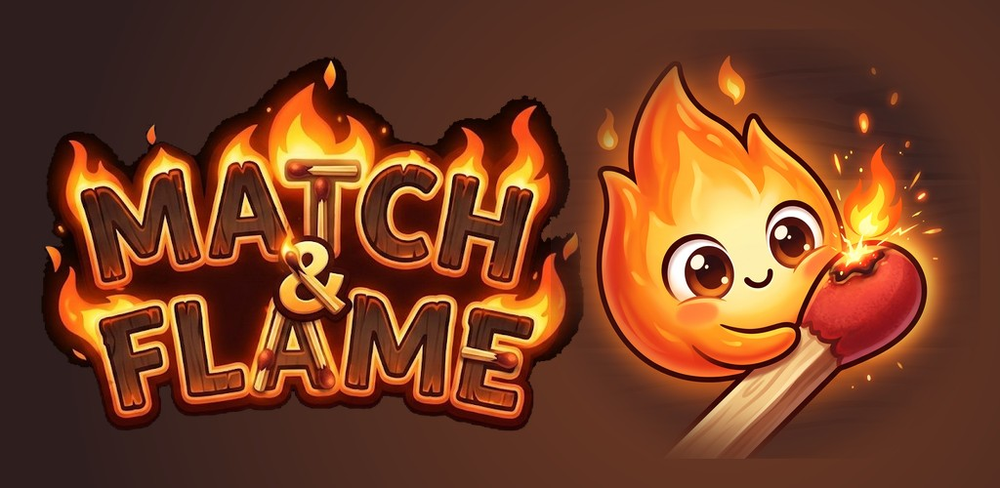
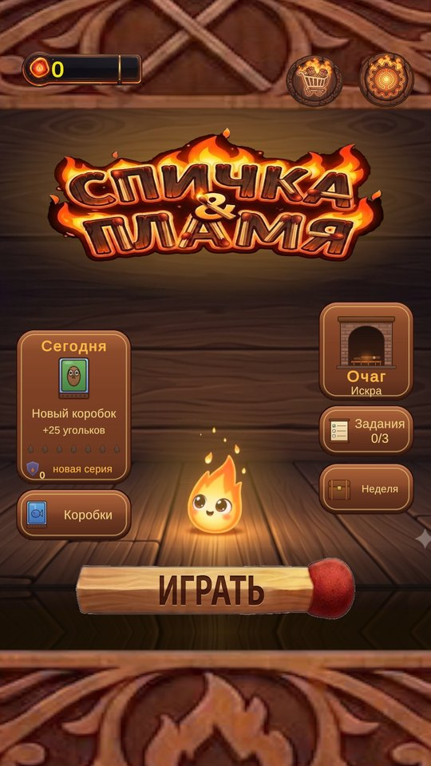
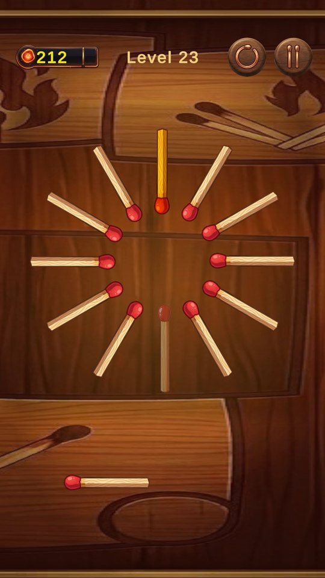
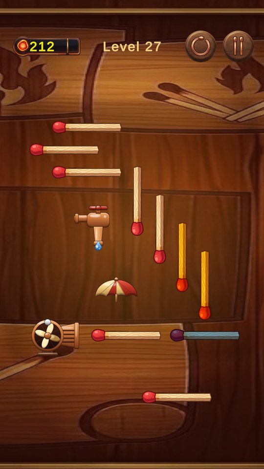
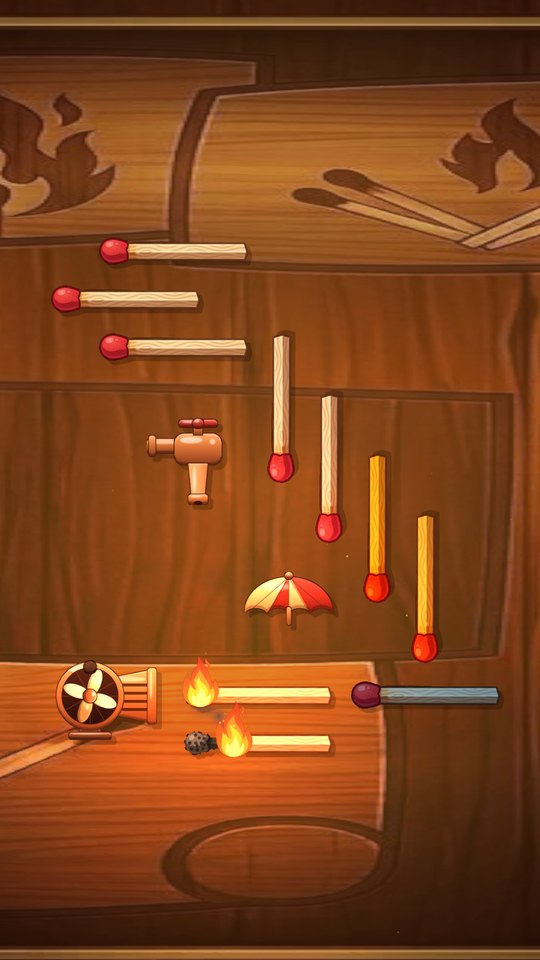
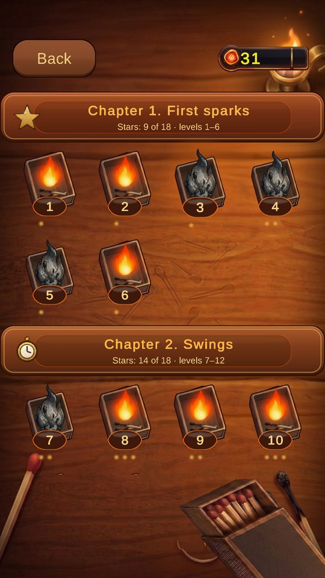
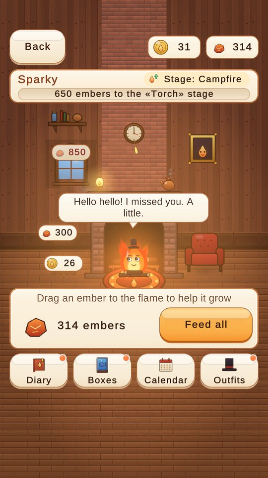
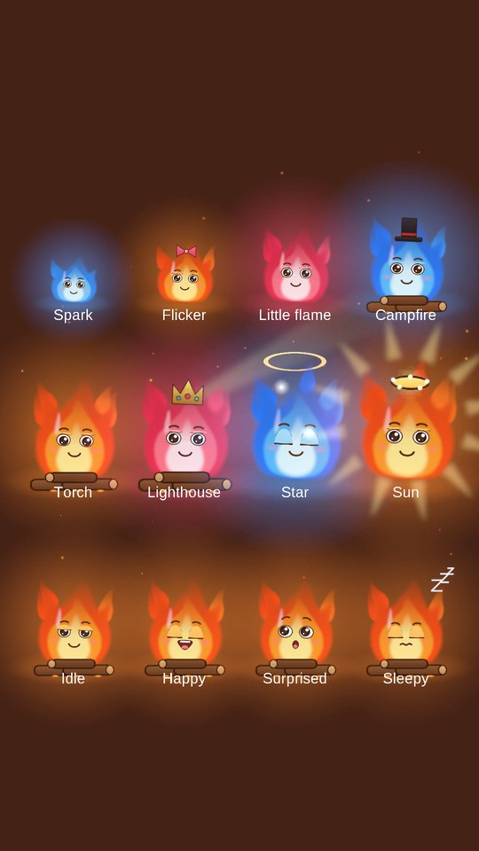
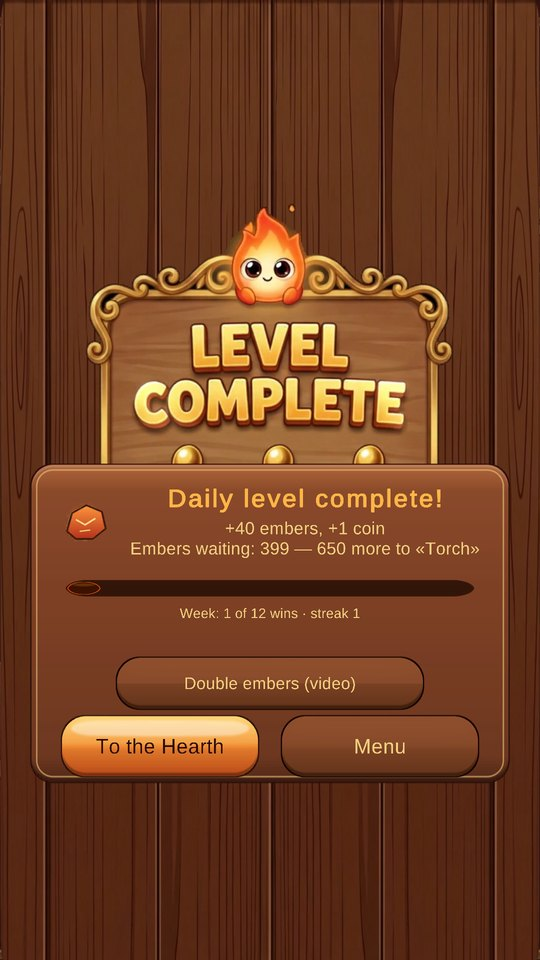

  

  
  
  
  
  

  

  <b>Arrange the matches so that one spark burns the whole board.</b> 
  <i>Расставьте спички так, чтобы одна искра сожгла всё поле.</i>

  <a href="#english"><b>English</b></a> · <a href="#russian"><b>Русский</b></a>

## Screenshots · Скриншоты

<table>
  <tr>
    <td align="center"> <b>Main menu</b> Главное меню</td>
    <td align="center"> <b>Build the chain</b> Постройте цепочку</td>
    <td align="center"> <b>Water, wind, umbrellas</b> Вода, ветер, зонтики</td>
    <td align="center"> <b>Light it up</b> Поджигайте</td>
  </tr>
  <tr>
    <td align="center"> <b>6 chapters, 32 levels</b> 6 глав, 32 уровня</td>
    <td align="center"> <b>The Hearth</b> Очаг</td>
    <td align="center"> <b>Grow your flame</b> Растите огонёк</td>
    <td align="center"> <b>Daily level</b> Уровень дня</td>
  </tr>
</table>

---

## 🇬🇧 English

### About

**Match & Flame** is a relaxing but tricky puzzle game for Android and the web. Every level is a wooden board with matches on it. Drop your own match in the right place, light it, and watch the fire run from match to match. If the chain breaks, the board does not burn.

### How to play

1. **Drag** your match onto the board.
2. **Tap** it to rotate by 90°.
3. Fire passes from the **head** of a burning match to the **tail** of the next one, so line them up carefully.
4. **Ignite** and watch the chain reaction. The more of the board burns, the more stars you get: burn every match for **3 stars**.

### Features

| | Feature | Details |
|---|---|---|
| 🧩 | **32 hand-made levels** | 6 chapters: *First sparks*, *Swings*, *Sleight of hand*, *Water and wind*, *Workshop*, *Great fire* |
| 📅 | **Daily level** | A new puzzle every day from a pool of 60, with its own reward and a win streak |
| 🔥 | **The Hearth** | A home for your little flame: feed it embers and it grows through 8 stages, from a spark to a sun |
| 🎩 | **26 outfits** | Earned for flame stages, weekly goals, holiday events and secret matchboxes |
| 📦 | **Matchbox collection** | 32 boxes: 6 themed sets (Forest, Sea, City, Kitchen, Circus, Space) and 8 seasonal boxes |
| 🛋️ | **Room decor** | 10 items for the Hearth room: rug, armchair, clock, kettle and more |
| ✅ | **Tasks and weekly goals** | 3 daily tasks and a weekly theme (Water week, Wind week, Golden week…) |
| 🎉 | **Holiday events** | New Year, Nauryz, Spring, Summer, Halloween and others, with their own outfits |
| 🛒 | **Shop** | 4 flame skins for in-game coins. No paid purchases |
| 🌍 | **RU / EN** | Full localization, music and SFX toggles, effects quality setting |

### Mechanics

| Element | What it does |
|---|---|
| 🔴 **Match** | Burns and passes the fire from its head to the tail of the next match |
| 🟡 **Golden match** | Burn it to collect a coin |
| 🔵 **Blue match** | Can't be lit by your match. Only another match from the chain can light it |
| 🚰 **Tap** | Drops put out burning matches and soak unburnt ones for a few seconds |
| ☂️ **Umbrella** | Catches drops and protects the matches under it |
| 🌀 **Fan** | Wind pushes the fire further downwind, holds it back upwind, and a strong gust blows it out |
| ⏱️ **Pendulum** | Matches and obstacles swing on a timer, so the moment of ignition matters |

### The Hearth: flame stages

| Stage | Embers | Reward |
|---|---:|---|
| Spark | 0 | — |
| Flicker | 120 | Bow |
| Little flame | 360 | Scarf |
| Campfire | 800 | Glasses |
| Torch | 1 450 | Top hat |
| Lighthouse | 2 300 | Headphones |
| Star | 3 400 | Crown |
| Sun | 4 800 | Star halo |

### Tech

| Area | Stack |
|---|---|
| Engine | Unity **6000.2.13f1**, C# |
| Rendering | Universal Render Pipeline 2D, custom flame, sparks, smoke and ash effects |
| UI | uGUI + TextMeshPro. The Hearth screens are built from code (`Assets/Scripts/Retention/`) |
| Android | Android 7.0+ (API 24), target API 36, IL2CPP, App Bundle |
| Ads | Google Mobile Ads + UMP consent (Android) |
| Web | PluginYourGames 2 for Yandex Games (WebGL) |
| Art pipeline | Procedural sprites drawn with Python + Pillow + NumPy (`Tools/`), packed into sprite atlases |
| Editor tools | Level Lab (builder, solver, simulator), UI Lab (layout audit on 6 resolutions), release build with pre-checks |

### Project structure

| Path | What's inside |
|---|---|
| `Assets/Scripts/` | Game code: levels, matches, burning, shop, ads, localization |
| `Assets/Scripts/Mechanics/` | Tap, umbrella, fan, level clock |
| `Assets/Scripts/Retention/` | The Hearth: daily level, tasks, collection, flame character, UI |
| `Assets/Levels/`, `Assets/Resources/` | Level prefabs, catalogs, settings, daily level pool |
| `Assets/Art/`, `Assets/Sounds/`, `Assets/Videos/` | Graphics, audio, menu video |
| `Assets/Editor/` | Editor tools: Level Lab, UI Lab, Retention tools, release build |
| `Tools/` | Python scripts that generate procedural art |
| `docs/` | Build guide (English) and game design notes (Russian) |

### Building

Full guide: **[docs/BUILD.md](docs/BUILD.md)**. In short:

1. Open the project in **Unity 6000.2.13f1** with Android Build Support.
2. Import **Google Mobile Ads for Unity** and copy `BuildSetup/AdIds.Example.cs` to `Assets/Scripts/AdIds.cs`.
3. Use your own package name, keystore and privacy policy URL.
4. Build with **Tools → Match & Flame → Build → Release AAB for Google Play**.

### License

- **Code** (C# scripts, editor tools, Python tools) is under the [MIT License](LICENSE).
- **Graphics, sounds, music and video** (`Assets/Art/`, `Assets/Sounds/`, `Assets/Videos/`, `docs/images/` and other art assets) are **not** covered by MIT unless they come from a free source with its own license. They are **all rights reserved**: please don't reuse them in your own projects without permission.
- Third-party packages keep their own licenses: PluginYourGames 2 (CC0), External Dependency Manager (Apache 2.0), TextMesh Pro and Unity packages (Unity Companion License).

The name *Match & Flame* and the Google Play listing belong to their owner. Forks must use their own package name, keystore and store listing.

---

## 🇷🇺 Русский

### Об игре

**Спичка & Пламя** (Match & Flame) — спокойная, но хитрая головоломка для Android и браузера. Каждый уровень — деревянная доска со спичками. Поставьте свою спичку в нужное место, подожгите и смотрите, как огонь бежит от спички к спичке. Если цепочка где-то рвётся, поле не сгорит.

### Как играть

1. **Перетащите** свою спичку на поле.
2. **Нажмите** на неё, чтобы повернуть на 90°.
3. Огонь переходит от **головки** горящей спички к **хвосту** следующей, поэтому выстраивайте их точно.
4. **Подожгите** и смотрите на цепную реакцию. Чем больше спичек сгорело, тем больше звёзд: за всё поле — **3 звезды**.

### Возможности

| | Что | Подробности |
|---|---|---|
| 🧩 | **32 уровня ручной работы** | 6 глав: «Первые искры», «Качели», «Ловкость рук», «Вода и ветер», «Мастерская», «Большой огонь» |
| 📅 | **Уровень дня** | Каждый день новая задачка из 60, со своей наградой и серией побед |
| 🔥 | **Очаг** | Дом для вашего огонька: кормите его угольками, и он вырастет за 8 стадий из искры в солнце |
| 🎩 | **26 нарядов** | За стадии огонька, недельные цели, праздники и секретные коробки |
| 📦 | **Коллекция коробков** | 32 коробка: 6 тематических наборов (Лес, Море, Город, Кухня, Цирк, Космос) и 8 сезонных |
| 🛋️ | **Обстановка комнаты** | 10 предметов для Очага: коврик, кресло, часы, чайник и другие |
| ✅ | **Задания и цели недели** | 3 задания в день и тема недели («Неделя воды», «Неделя ветра», «Золотая неделя»…) |
| 🎉 | **Праздники** | Новый год, Наурыз, Весна, Лето, Хэллоуин и другие, у каждого свой наряд |
| 🛒 | **Магазин** | 4 скина огонька за игровые монеты. Платных покупок нет |
| 🌍 | **RU / EN** | Полная локализация, отдельно музыка и звуки, настройка качества эффектов |

### Механики

| Элемент | Что делает |
|---|---|
| 🔴 **Спичка** | Горит и передаёт огонь от головки к хвосту следующей спички |
| 🟡 **Золотая спичка** | Сожгите её — получите монету |
| 🔵 **Голубая спичка** | Не загорается от вашей спички, только от другой спички в цепочке |
| 🚰 **Кран** | Капли тушат горящие спички, а несгоревшие на несколько секунд намокают |
| ☂️ **Зонтик** | Ловит капли и защищает спички под собой |
| 🌀 **Вентилятор** | По ветру огонь перелетает дальше, против ветра — не дотягивается, а сильный поток задувает пламя |
| ⏱️ **Маятник** | Спички и препятствия качаются по таймеру, поэтому важен момент поджога |

### Очаг: стадии огонька

| Стадия | Угольков | Награда |
|---|---:|---|
| Искра | 0 | — |
| Язычок | 120 | Бантик |
| Огонёк | 360 | Шарфик |
| Костёр | 800 | Очки |
| Факел | 1 450 | Цилиндр |
| Маяк | 2 300 | Наушники |
| Звезда | 3 400 | Корона |
| Солнце | 4 800 | Звёздный нимб |

### Технологии

| Область | Что используется |
|---|---|
| Движок | Unity **6000.2.13f1**, C# |
| Графика | Universal Render Pipeline 2D, свои эффекты пламени, искр, дыма и пепла |
| Интерфейс | uGUI + TextMeshPro. Экраны Очага собираются из кода (`Assets/Scripts/Retention/`) |
| Android | Android 7.0+ (API 24), target API 36, IL2CPP, App Bundle |
| Реклама | Google Mobile Ads + согласие UMP (Android) |
| Веб | PluginYourGames 2 для Яндекс Игр (WebGL) |
| Графика из кода | Процедурные спрайты на Python + Pillow + NumPy (`Tools/`), собираются в атласы |
| Инструменты редактора | Level Lab (конструктор, решатель, симулятор), UI Lab (проверка вёрстки на 6 разрешениях), релизная сборка с проверками |

### Структура проекта

| Путь | Что внутри |
|---|---|
| `Assets/Scripts/` | Код игры: уровни, спички, горение, магазин, реклама, локализация |
| `Assets/Scripts/Mechanics/` | Кран, зонтик, вентилятор, часы уровня |
| `Assets/Scripts/Retention/` | Очаг: уровень дня, задания, коллекция, огонёк, интерфейс |
| `Assets/Levels/`, `Assets/Resources/` | Префабы уровней, каталоги, настройки, пул уровней дня |
| `Assets/Art/`, `Assets/Sounds/`, `Assets/Videos/` | Графика, звук, видео меню |
| `Assets/Editor/` | Инструменты редактора: Level Lab, UI Lab, инструменты Очага, релизная сборка |
| `Tools/` | Python-скрипты, которые рисуют процедурную графику |
| `docs/` | Инструкция по сборке и заметки по геймдизайну (на русском) |

### Сборка

Подробная инструкция: **[docs/BUILD.md](docs/BUILD.md)** (на английском). Коротко:

1. Откройте проект в **Unity 6000.2.13f1** с модулем Android Build Support.
2. Импортируйте **Google Mobile Ads for Unity** и скопируйте `BuildSetup/AdIds.Example.cs` в `Assets/Scripts/AdIds.cs`.
3. Укажите свои имя пакета, keystore и ссылку на политику конфиденциальности.
4. Соберите через **Tools → Match & Flame → Build → Release AAB for Google Play**.

### Лицензия

- **Код** (скрипты C#, инструменты редактора, Python-инструменты) распространяется по [лицензии MIT](LICENSE).
- **Графика, звуки, музыка и видео** (`Assets/Art/`, `Assets/Sounds/`, `Assets/Videos/`, `docs/images/` и другие арт-ассеты) под MIT **не** подпадают, если они не взяты из свободного источника со своей лицензией. Все права на них защищены: не используйте их в своих проектах без разрешения.
- Сторонние пакеты распространяются по своим лицензиям: PluginYourGames 2 (CC0), External Dependency Manager (Apache 2.0), TextMesh Pro и пакеты Unity (Unity Companion License).

Название *Match & Flame* и страница в Google Play принадлежат их владельцу. Форки должны использовать своё имя пакета, keystore и страницу в магазине.
